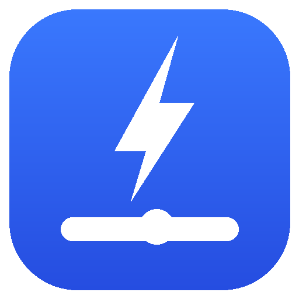

# dsh-codex-model-picker

A Codex-style model picker for the [DeepSeek Harness](https://github.com/deepseek-ai/deepseek-harness) composer.

It replaces the composer's model menu with a small card — the reasoning effort on top, the current model below it, and a draggable effort slider at the bottom — the way Codex's model switcher works.



## Features

- **Codex-style card** anchored above the composer model button, flipping below when there is no room.
- **Draggable effort slider** with one stop per effort the model actually advertises (`off`, `minimal`, `low`, `medium`, `high`, `xhigh`, `max` when advertised). The thumb snaps to whole stops, animates between them, and the effort label updates while you drag, not only after you release.
- **No provider-default stop.** Levels come from the adapter's advertised `reasoning.efforts`. A model without a stored effort shows `medium` when available, otherwise its advertised default (or the middle level), never a synthetic "default" entry.
- **`Off` stop** when the model advertises it; committing it sends `reasoningEffort: "off"`, which providers like Codex map to "no reasoning".
- **Model list** with provider grouping, the current selection, badges, loading and error states, and keyboard navigation.
- **Full keyboard support**: arrows move one stop, `Home`/`End` jump to the ends, `Escape` closes and returns focus.
- **Theme-aware**: every color, radius and shadow comes from DSH theme tokens, light and dark.
- **Chinese and English UI.**

## Requirements

- DeepSeek Harness `0.2.2-rc.1` or newer (the client slot API it shadows was stabilized in this line).
- A web profile (`dsh web` or the desktop app).

## Install

```sh
dsh plugin --profile web add github:caidows/dsh-codex-model-picker
```

Then reload the page. The plugin registers a client slot occupant at priority `-1` on `conversation.input.model`, shadowing the shipped picker; disabling or removing the plugin restores the stock picker with no state left behind.

To install from a checkout, point `dsh plugin add` at the package directory instead.

## How it works

`cordis.patch.yml` inserts one row, `codex-model-picker`, which loads the client bundle in `client.js`. The bundle renders into the composer's model slot and reads the same per-session model directory (`ctx.modelDirectories.directoryFor(sessionId)`) the shipped picker uses, so model switches and effort switches go through `session.selectModel` and stay in sync with the rest of the UI.

`view.js` and `style.css` are the sources; `client.js` is generated:

```sh
node build.mjs
```

## License

MIT
