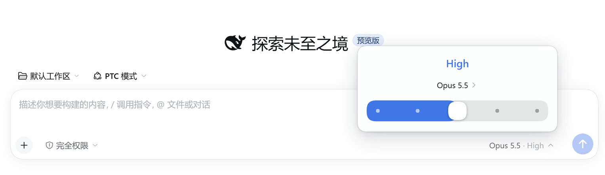

# dsh-codex-model-picker

把 [DeepSeek Harness](https://github.com/deepseek-ai/deepseek-harness) 输入框的模型选择换成 Codex 风格的卡片：顶部是推理强度，中间是当前模型，底部是一条可拖动的推理强度滑杆。

## 截图



## 功能

- **Codex 风格卡片**：贴在输入框模型按钮上方，空间不够时自动翻到下方。
- **可拖动的推理档位滑杆**：每个档位对应模型真实声明的 `reasoning.efforts`（`off`、`minimal`、`low`、`medium`、`high`、`xhigh`、`max`，模型声明了才有）。滑杆只会停在整档上，档位之间有过渡动画，拖动时推理强度文字即时变化，不用等松手。
- **没有「默认」档位**：档位全部来自模型声明。没有显式选择时显示 `medium`（模型支持的话），否则用模型声明的默认档或中间档，不再合成一个「默认」项。
- **`Off` 档位**：模型声明了 `off` 就有这一档；提交时发送 `reasoningEffort: "off"`，Codex 等提供方会把它当作「不推理」。
- **模型列表**：按提供商分组、显示当前选择与徽标，支持加载 / 错误状态和键盘导航。
- **完整键盘操作**：方向键换档、`Home` / `End` 跳到两端、`Escape` 关闭并归还焦点。
- **跟随主题**：颜色、圆角、阴影全部取自 DSH 主题 token，亮色暗色都正常。
- **中文 / 英文界面。**

## 环境要求

- DeepSeek Harness `0.2.2-rc.1` 或更新版本。
- Web 配置（`dsh web` 或桌面版）。

## 安装

```sh
dsh plugin --profile web add github:caidows/dsh-codex-model-picker
```

装好后刷新页面即可。插件在 `conversation.input.model` 槽位上以 `-1` 优先级注册，覆盖自带的模型选择器；停用或卸载插件就会恢复原样，不会留下状态。

## 实现说明

`cordis.patch.yml` 插入一行 `codex-model-picker` 来加载 `client.js`。前端 bundle 注册到输入框的模型槽位，读取的仍是自带选择器用的 per-session 模型目录（`ctx.modelDirectories.directoryFor(sessionId)`），所以模型与推理档位的切换都走 `session.selectModel`，与界面其他部分保持一致。

`view.js` 与 `style.css` 是源码，`client.js` 由构建生成：

```sh
node build.mjs
```

## 许可证

MIT
